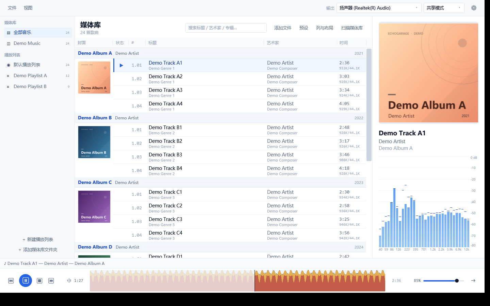
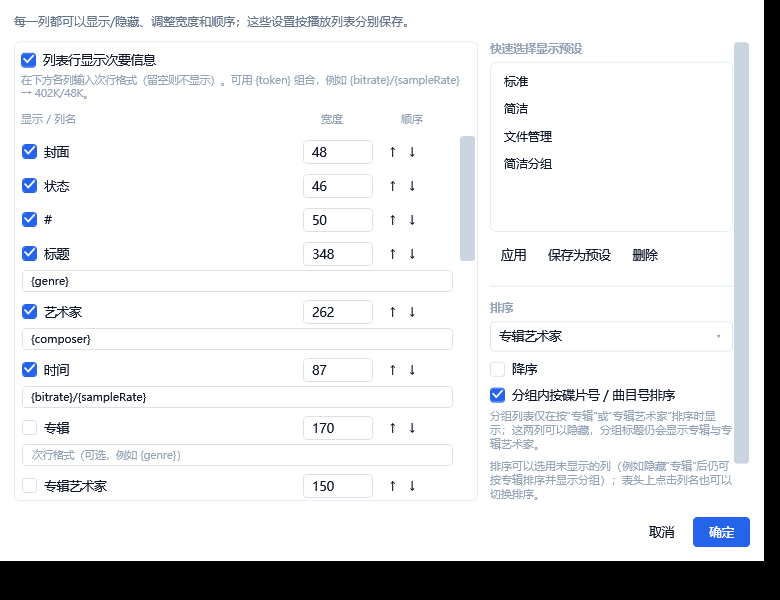
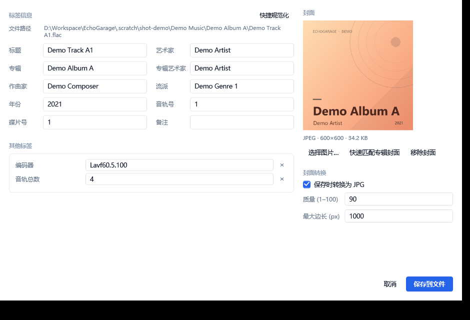
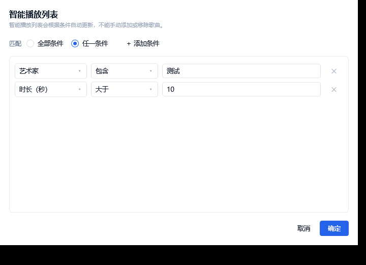
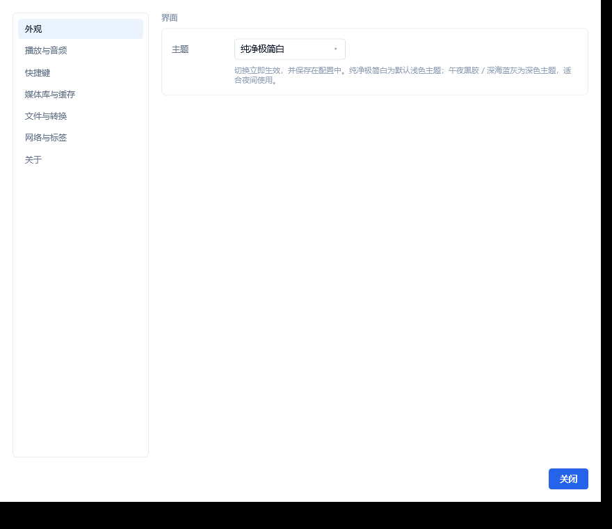
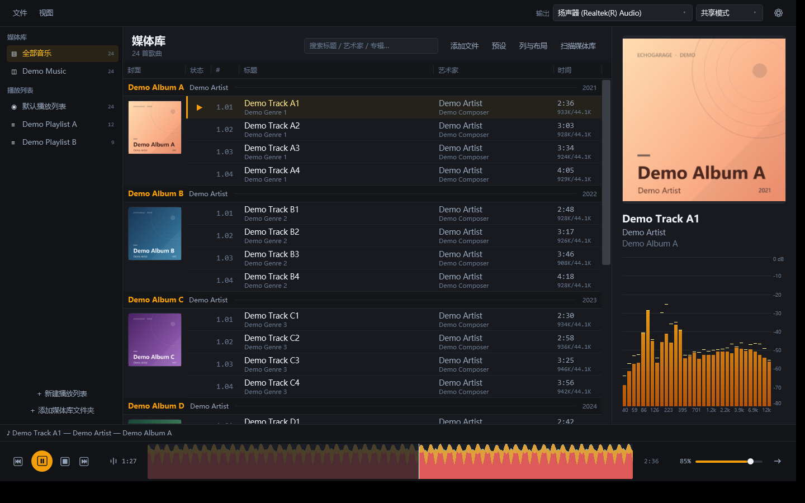
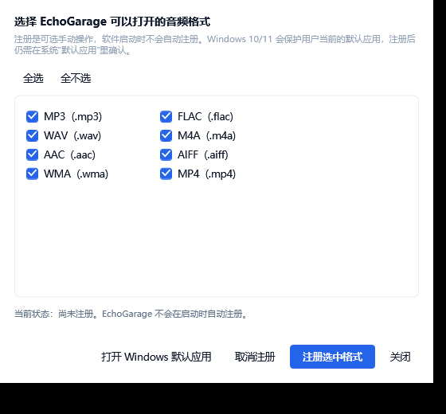

# EchoGarage

EchoGarage 是一个面向个人使用的 Windows 本地音乐播放器，目标是只保留真正需要的功能，并把每一项做到顺手：
快速启动、快速加载、可自定义的播放列表显示、真实的文件标签读写，以及共享 / WASAPI 独占两种输出方式。
界面提供五套主题、整曲波形进度条与右栏频谱可视化，并内置标签工具、Web 标签搜索、响度计算与音频转换。

当前版本：**v0.1.0**（可运行的第一版，功能持续迭代中）。



### 界面一览

| 列与布局 | 标签属性 |
| --- | --- |
|  |  |

| 智能播放列表 | 设置 |
| --- | --- |
|  |  |

| 深色主题 | 文件关联 |
| --- | --- |
|  |  |

## 功能

### 界面与主题
- 内置五套主题：**纯净极简白**（默认）、**温润纸感白**、**极简冰青白**、**午夜黑胶**、**深海蓝灰**。
  可在“视图 → 主题”或设置中切换，立即生效并保存到配置；窗口标题栏与对话框跟随当前主题。
- 所有界面颜色都由主题令牌（`DynamicResource`）驱动，不在控件里硬编码颜色；新增主题只需增加一个主题字典。
- 三栏布局：左侧媒体库 / 播放列表导航，中间歌曲列表，右侧“正在播放”面板（封面、曲目信息与播放可视化）。
  左右分栏宽度可拖拽调整，右侧面板可收起；宽度与显隐状态会记住。
- 顶部只保留“文件 / 视图”菜单，右侧是输出设备、输出模式下拉与设置入口；状态栏显示当前播放与瞬时提示。
- 列表工具栏内置搜索框：输入即过滤当前浏览的播放列表，默认匹配标题 / 艺术家 / 专辑 / 专辑艺术家，
  支持多关键词 AND 与引号短语；过滤后显示匹配数量，分组视图同步收敛，`Esc` 或 ✕ 清空。
- `Ctrl+F`（可改键）打开高级搜索：可只搜某一个字段，或同时对多个字段查找同一关键词（任一字段 / 全部字段匹配），
  搜索范围限于当前播放列表。
- 列与布局按播放列表分别记忆：列的显示 / 隐藏、宽度、顺序、排序列与升降序；拖拽表头直接调整即保存，无需另行确认。
  可保存为全局预设快速套用，媒体库视图有独立显示格式。
- 每列可配置“次行”次要信息（复合占位符，例如 `{bitrate}/{sampleRate}` → `402K/48K`），
  列表行会在主行下方显示较小、较淡的一行；封面 / 状态 / `#` 三列不显示次行。
- `#` 列在文件带碟片号时显示为“碟片号.音轨号”（如 `1.01`）；隐藏的列仍可用于排序与分组。
- 分组视图（视图 → 按专辑分组）：分组标题压缩为一行，封面位于该专辑左侧的独立封面栏，纵向覆盖整组歌曲；
  拖动“封面”栏右缘即可调整封面大小（48–320px，按播放列表记忆）。组内默认按碟片号 → 曲目号升序，可关闭。
- 分组表头支持把列固定在右侧、拖动任意列头调整宽度，拖动时表头与可见行实时同步，列宽与固定方式随显示格式持久化。
- 视图菜单内置“显示字段说明…”：可选中、可复制的字段文档（次要信息占位符、列名、排序与分组规则）。

### 播放与输出
- 支持 WAV、FLAC、MP3、AAC/M4A（以及系统 Media Foundation 能解码的 WMA、AIFF、MP4 音频）。
- 输出设备选择；共享模式与 WASAPI 独占模式切换（独占模式会独占声卡，其他程序无法同时出声），
  独占不可用时自动回退共享并记录日志。
- 进度条支持两种形态：滑块（默认）与**整曲波形**（在设置中切换）。波形按低 / 中 / 高三频段着色，
  边播边渐进加载；波形缓存上限可配置，也可在设置中一键清空。
- 进度条点击 / 拖动跳转，上一首 / 下一首 / 停止；波形形态下拖动只预览时间、松手才真正跳转。
- 音量区域保留百分比与音量条：点击百分比切换静音（静音时标红并加删除线，数字不变），
  鼠标悬停在音量区域时可用滚轮以 5% 为步进调整音量（向上即取消静音）。
- 播放模式三态：顺序播放 / 随机播放 / 单曲循环（传输栏最右侧按钮或右键菜单切换，立即生效并保存）。
  随机模式一轮内不重复，播放到一轮结束自动重新洗牌；切换播放列表或过滤结果时随机队列重置。
- 系统媒体键（播放 / 暂停、上一首、下一首）默认控制 EchoGarage；播放失败自动跳过并写入日志。
- 切歌会立即移除上一首封面；右侧封面加载时显示旋转指示，不会出现旧封面残留。

### 播放可视化与封面
- 右栏“正在播放”面板下方显示实时的**分段频谱图**；可视化方式、频段数、FFT 大小、频率范围、
  弹道参数、峰值保持、刻度与频率标签、渲染帧率上限等均可在“设置 → 播放与音频”中调整，改动立即生效并随配置保存。
- 双击右栏封面可打开封面大图浏览窗口：支持缩放、拖动与关闭，窗口非模态，不影响播放。

### 媒体库
- 添加任意数量本地文件夹到媒体库，递归扫描支持的音频文件。
- 扫描采用“文件大小 + 修改时间”比对，未变化的文件不会重复读标签；缓存行缺少时长等无效缓存会被判定为失效，
  在下次扫描时自动重建。标签读取并行执行（最多 8 个线程），扫描阶段不把内嵌封面读入内存。
- `FileSystemWatcher` 监听媒体库目录：新增 / 修改 / 删除 / 重命名自动同步，去抖后只处理变化的文件。
- 播放列表里的外部文件（媒体库目录之外）不会被扫描器 / 监听器覆盖；切换来源、重新打开或重新激活窗口时，
  后台比对文件大小与修改时间，发现变化就重新读取标签并刷新当前列表。
- 标签与封面从音频文件读取；封面按专辑缓存到可配置目录，未找到封面也会记录负缓存，避免反复解析。

### 播放列表
- **普通播放列表**：手动添加、拖拽文件或文件夹、从媒体库添加、移除歌曲；支持按住左键拖出选框批量选择
  （Ctrl 追加选择，拖到列表上下边缘自动滚动）。
- **智能播放列表**：由筛选条件生成（字段 + 比较方式 + 值，支持“全部条件 / 任一条件”），条件锁定，不允许手动增删歌曲。
- **默认播放列表**：从资源管理器“用 EchoGarage 打开”多个文件时，自动用这些文件覆盖默认播放列表并开始播放。
- 播放列表导航支持新建、重命名、删除与拖拽排序；可把所选歌曲添加到其它播放列表。
- 播放列表可引用媒体库目录以外的文件；文件被删除或移动后，条目以半透明显示并提示，双击会提示文件不存在。
- 显示格式（列、次行、分组封面、表头固定等）按播放列表分别记忆，媒体库视图独立。

### 标签编辑与标签工具
- 右键歌曲 → 属性：2 列 × N 行的表格式表单，可编辑标题、艺术家、专辑、专辑艺术家、作曲家、流派、年份、音轨号、
  碟片号、备注与封面；年份保留文件中的原始日期文本，不擅自改写。
- 支持多选批量编辑：各文件字段值一致时合并显示，不一致时显示 `<多值>`，可用右侧下拉选择；保存时只写入修改过的字段，
  未修改字段保留每个文件自己的原值（类似 Mp3tag 的 `<keep>` 语义）。
- 多选封面同样按“多值”语义处理；编辑正在播放的文件的标签不会中断播放（共享句柄 + 临时文件原子替换，
  见 [`docs/adr/ADR-020-playing-file-write-lock.md`](docs/adr/ADR-020-playing-file-write-lock.md)）。
- 常用字段下方只读列出文件里的其它标签（BPM、ISRC、发行方、编码器、MusicBrainz、ReplayGain、歌词等）。
  标签直接写入音频文件，不写入播放器数据库；保存后立即重读并刷新列表、当前播放信息与封面缓存。
- 艺术家 / 专辑艺术家 / 作曲家 / 流派字段提供媒体库候选值下拉，可直接补全常用写法
  （见 [`docs/adr/ADR-025-tag-normalization-rules.md`](docs/adr/ADR-025-tag-normalization-rules.md)）。
- **标签规范化**：在设置中维护正则规则（内置两条示例规则：清理 EP / Single 后缀、统一日期格式），
  可在歌曲右键“标签规范化”菜单或标签属性窗口“快捷规范化”里按启用的规则批量改写标签；非法正则不会生效。
- **Web 搜索标签**：右键“Web 搜索标签…”打开三步窗口（搜索专辑 → 选择结果 → 匹配与写入），
  当前内置 Apple Music（日本）网页源；支持代理设置、字段勾选记忆、逐曲匹配与拖动修正，绝不按顺序强配。
- 右侧封面区显示图片格式、分辨率与体积；“选择图片…”默认打开歌曲所在目录，“快速匹配专辑封面”会在目录内自动挑选图片。
  可勾选“保存时转换为 JPG”（默认开启）并设置 JPG 质量与最大边长：只缩小不放大、等比缩放，转换后不更小则保留原图。
- **文件操作**：右键歌曲可复制到 / 移动到指定目录（目标目录在设置中维护，也可选择其它目录）或删除到回收站；
  操作后同步数据库与播放列表，删除到回收站后普通播放列表中的对应条目会被移除
  （见 [`docs/adr/ADR-021-file-operations.md`](docs/adr/ADR-021-file-operations.md)）。

### 音频转换与响度
- 选中歌曲 → 右键“转换” → 选择预设，即可转换为 AAC / FLAC / MP3 / WAV；每个预设可配置（全局）快捷键。
- “转换器设置…”（文件菜单或右键“转换”子菜单）管理预设：输出格式、码率模式（VBR / ABR / CBR）、质量或比特率、
  位深、输出位置、文件名模板（支持子目录）、冲突处理（询问 / 跳过 / 覆盖 / 自动重命名）、重采样（目标采样率与 SSRC 质量档）、
  标签与内嵌封面复制。
- 内置预设：MP3 320 kbps CBR、FLAC 无损（级别 5）、AAC（Nero）Q1.00、WAV 16-bit；目标文件已存在时默认先询问一次，
  选择后对整批文件生效；转换不会修改或删除源文件，过程可随时取消，失败文件结束时汇总提示。
- FLAC / LAME / SSRC 编码器随发布包附带（`tools\`，附许可文件与源码说明）；Nero AAC 因许可限制不随包分发，
  需要在转换器设置中指定自备的 `neroAacEnc.exe`。
- **响度计算**：右键“响度计算…”对一首或多首歌曲做 ITU-R BS.1770-5 / EBU R128 测量，非模态窗口展示
  Integrated LUFS、Loudness Range、True Peak 与动态范围等结果；只读分析，不写标签、不产生缓存。
- **响度调整**：右键“响度调整…”对单首歌曲按测量结果做线性增益并输出新文件，目标响度默认 -10 LUFS（可在设置中调整），
  真峰值天花板分别为无损 -1.0 dBTP / 有损 -2.0 dBTP，16-bit 输出使用 TPDF dither；不修改源文件。

### 快捷键

| 按键 | 功能 |
| --- | --- |
| 双击歌曲 / Enter | 播放选中歌曲 |
| 空格 | 播放 / 暂停 |
| Alt+Enter | 打开选中歌曲的属性（标签编辑） |
| Delete | 从当前普通播放列表移除所选歌曲 |
| Ctrl+O | 添加文件到当前播放列表 |
| F5 | 重新扫描媒体库 |
| Ctrl+F | 打开高级搜索（可改键；未配置时使用默认组合） |
| Ctrl+M | 静音 / 取消静音 |
| 媒体键 | 播放 / 暂停、上一首、下一首（系统媒体键默认控制本程序） |

播放控制（播放 / 暂停、上一首、下一首、停止、静音）、打开高级搜索以及每个转换预设都可以在“设置 → 快捷键”中
改为自定义组合（捕获式设定，例如 `Ctrl+Alt+Space`、`MediaPlayPause`），并可为每一项勾选“全局”：
勾选后即使焦点在其他程序，快捷键也会生效。全局快捷键由系统注册，组合被占用时记录日志并跳过。

### 配置与数据
- 软件配置（`settings.json`）与媒体库数据（`library.db`）分离；配置可导出 / 导入，导入不会影响媒体库与播放列表。
- 封面缓存与波形缓存目录可配置；修改后自动迁移已有封面缓存，支持分别或一键清空缓存。
- 默认便携模式：所有状态都在 exe 旁的 `EchoGarageData`，不读写 `%APPDATA%` / `%LOCALAPPDATA%`；
  可用 `ECHOGARAGE_DATA_DIR` 把全部状态重定向到指定目录（见下文“目录与环境变量”）。
- 文件关联是**可选的手动操作**：在“文件关联”对话框里勾选需要关联的格式后才会写入；启动时不会自动注册，
  也不会改写现有的默认打开方式。Windows 10/11 需在系统“默认应用”里确认。
- 界面不展示评分 / 播放次数等动态统计信息；数据库中的历史字段保留，但不再新增相关功能。

## 技术栈

| 层 | 选型 |
| --- | --- |
| 运行时 | .NET 10（WPF，x64） |
| UI | WPF，自绘五套主题（主题令牌字典），无第三方 UI 框架 |
| 播放 | NAudio 2.2（`WasapiOut` / `SharedAudioFileReader` / `WdlResamplingSampleProvider`） |
| 波形 / 可视化 | 自研 STFT 波形分析与分段频谱（EGWV 波形缓存、播放样本抽头） |
| 标签 | TagLib# 2.3（`TagLibSharp`） |
| 响度 | 自研 ITU-R BS.1770-5 / EBU R128 流式测量（LUFS / LRA / True Peak） |
| 转换 | NAudio Media Foundation 解码 + 外部编码器（flac / LAME / SSRC，随包附带）+ Nero AAC（用户自备） |
| 数据 | SQLite（`Microsoft.Data.Sqlite` + Dapper，WAL 模式，`PRAGMA user_version` 迁移） |
| 日志 | 自研文件日志，按天分文件，保留 30 天 |
| 测试 | xUnit v3（进程内测试运行器） |

## 项目结构

```
EchoGarage.sln
├─ src/
│  ├─ EchoGarage.Core/           领域模型、设置、智能查询、布局规则（无 UI / IO 依赖）
│  ├─ EchoGarage.Infrastructure/ SQLite 仓储、扫描、文件监听、TagLib、封面/波形缓存、音频、转换、Web 标签
│  └─ EchoGarage.App/            WPF：窗口、视图模型、对话框、控件、单实例、文件关联、诊断
├─ tests/EchoGarage.Tests/       单元与集成测试
├─ tools/                        转换用外部工具（flac / LAME / SSRC + 许可文件）
├─ docs/                         ADR、KB、提案与界面截图
└─ scripts/                      构建、测试、发布脚本
```

目录职责与协作规范见 `AGENTS.md`。

## 开发

### 环境要求

- Windows 10 1809+ / Windows 11
- .NET 10 SDK（含 Windows Desktop 运行时）
- 可选：ffmpeg（仅用于生成本地测试音频）

### 构建与运行

```powershell
dotnet build EchoGarage.sln
dotnet run --project src/EchoGarage.App
```

### 测试

测试项目使用 xUnit v3 进程内运行器，直接运行可执行文件即可（不依赖 VSTest 宿主）：

```powershell
dotnet build tests/EchoGarage.Tests
.\tests\EchoGarage.Tests\bin\Debug\net10.0-windows\EchoGarage.Tests.exe
```

或 `.\scripts\test.ps1`。扩展名 / 设备 / 全局快捷键等依赖真实环境的行为，另按 `AGENTS.md` §7 做手动验证。

### 发布

```powershell
.\scripts\publish.ps1
# 输出：artifacts/publish/win-x64/EchoGarage.exe（依赖已安装的 .NET 10 Desktop Runtime）
```

脚本会同时把 `tools\` 下的编码器复制到发布目录；发布目录不放运行时数据，运行发布版前请按需设置
`ECHOGARAGE_DATA_DIR`。

### 目录与环境变量

| 内容 | 默认位置 |
| --- | --- |
| 配置 | `<exe 目录>\EchoGarageData\config\settings.json` |
| 数据库 / 日志 / 默认缓存 | `<exe 目录>\EchoGarageData\data\` |
| 封面缓存 | 默认 `<exe 目录>\EchoGarageData\data\Cache`，可在设置中修改 |
| 波形缓存 | 默认 `<exe 目录>\EchoGarageData\data\Waveforms`，可在设置中修改 |

因此程序文件夹需要可写（不要放在 `C:\Program Files` 之类受保护的位置）。实际使用的目录显示在“设置 → 关于”中。
设置环境变量 `ECHOGARAGE_DATA_DIR` 可以把以上全部内容重定向到指定目录（适合测试、共享盘或程序目录只读的情况）：

```powershell
$env:ECHOGARAGE_DATA_DIR = "G:\EchoGarageData"
.\artifacts\publish\win-x64\EchoGarage.exe
```

### 开发诊断开关

以下开关用于高 DPI / 无 UI 交互时检查界面与播放行为，执行完不会自动退出：

- `--screenshot <path>`：加载完成后把主窗口渲染成图片（内部为 PNG 编码，高 DPI 屏幕上比外部截屏可靠）。
- `--screenshot-all <dir>`：依次打开各对话框并截图，用于检查界面。
- `--play-file <path>` / `--seek-seconds <n>`：启动后播放指定文件并跳转到指定秒数。
- `--search <text>`：启动后立即应用列表搜索（无需注入键盘输入）。
- `--waveform <file> <png>`：本次启动强制使用波形进度条，播放指定文件，等波形分析完成后截图。
- `--visualizer <file> <png> [秒数]`：播放指定文件后在日志里输出右栏可视化的渲染帧率 / 分析耗时并截图。

### 截图约定

README 中的界面截图使用 `.scratch` 下临时构建的 dummy 演示媒体库生成（不包含真实歌曲 / 艺术家信息），
新增文件只放 JPG 以控制仓库体积；本地界面验证截图仍放在 `artifacts/` 或 `.scratch/`，不提交到仓库。

## 已知限制

- 仅支持 Windows。
- 暂不支持无缝播放、ReplayGain 标签读写与播放应用（响度计算 / 调整是独立的离线工具）、DSP、均衡器、歌词、网络串流、
  媒体库目录之外的自动扫描。
- 界面不展示评分 / 播放次数等动态统计信息。
- 智能播放列表条件基于媒体库内歌曲；播放列表布局随播放列表保存，媒体库布局保存在配置中。
- 导入大量文件（数万首）时首次扫描需要时间，之后依靠增量比对。
- 音频转换暂不支持 CUE 单文件专辑拆分、ReplayGain 计算与 DSP 处理；AAC 需要自备 Nero AAC 编码器。
- 文件关联只写入用户级注册表并需在系统“默认应用”中确认。

## 文档

- `README.md`：项目介绍与开发指引（本文件）。
- `AGENTS.md`：面向自动化 agent 的协作规范、目录说明与数据规则。
- `docs/adr/`：已批准的架构决策记录，索引见 `docs/adr/ADR-index.md`。
- `docs/kb/`：已批准的长期知识库（NAudio、WPF、TagLib、性能基线、主题、响度算法等）。
- `docs/proposals/`：尚未批准的 ADR / KB 提案；批准后才移入 `docs/adr/` 或 `docs/kb/`。
- `docs/screenshots/`：README 展示用的界面截图（JPG，由 demo 数据生成）。
