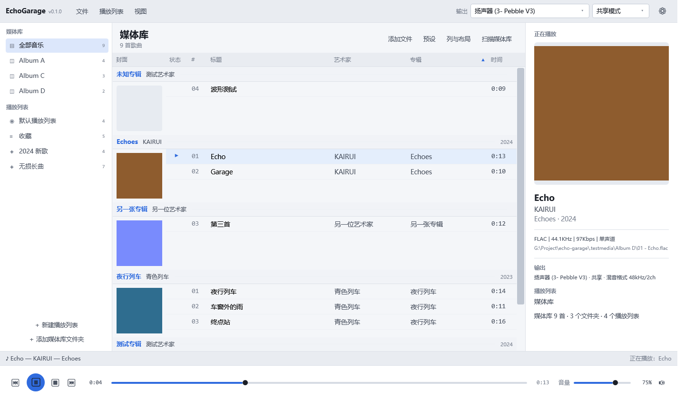
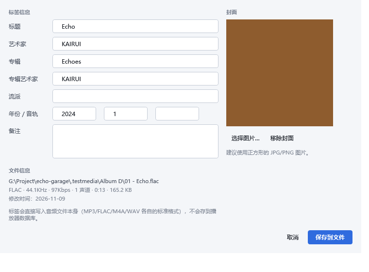
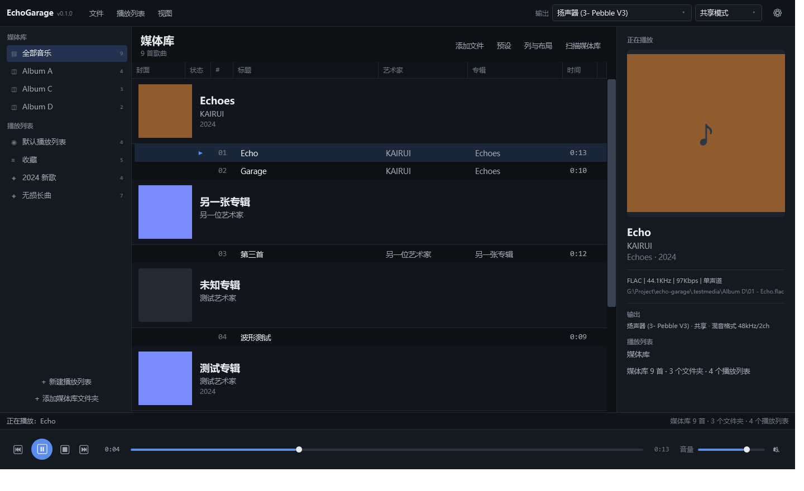
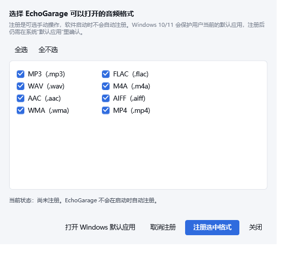

# EchoGarage

EchoGarage 是一个面向个人使用的 Windows 本地音乐播放器，目标是只保留真正需要的功能，并把每一项做到顺手：
快速启动、快速加载、可自定义的播放列表显示、真实的文件标签读写，以及共享 / WASAPI 独占两种输出方式。

当前版本：**v0.1.0**（可运行的第一版，功能持续迭代中）。



### 界面一览

| 列与布局 | 标签属性 |
| --- | --- |
|  |  |

| 智能播放列表 | 设置 |
| --- | --- |
|  |  |

| 深色主题 | 文件关联 |
| --- | --- |
|  |  |

## 功能

### 界面
- 提供**白色基底浅色**（默认）与**深色**两套主题，视图菜单或设置中切换后立即生效，并保存到配置。
- 所有界面颜色由主题字典（`DynamicResource`）驱动，后续新增主题不需要改控件代码。
- 深色 / 浅色都会同步调整窗口标题栏；对话框跟随当前主题。
- 列表右侧滚动条滑块有 12px 的最小高度，长列表下也更容易抓取和拖动。
- 底部状态栏显示当前播放曲目（`♪ 标题 — 艺术家 — 专辑`）；扫描 / 导入 / 错误等瞬时提示显示在右侧。
- 左侧媒体库 / 播放列表面板与右侧“正在播放”面板的宽度可以拖拽边界调整，范围分别限制在 170–420 / 240–520px，
  关闭时记住；隐藏“正在播放”面板时整列收起，列表自动占满宽度。右侧面板底部预留了未来可视化区域（如动态频谱），当前不显示统计信息。
- 双击状态栏的正在播放信息：若该曲在当前浏览的播放列表中，自动跳转并把该行居中显示；
  不在当前列表或没有播放时在状态栏给出提示（见 `docs/kb/KB-012-*`）。
- 传输栏按钮不再显示系统默认的虚线焦点框（悬停 / 按下反馈保留）。
- 左上角只保留“文件 / 播放列表 / 视图”菜单，不再显示品牌与版本文字；菜单为原生菜单栏，子菜单打开后把鼠标移到其它菜单会直接切换，点击可展开并保持展开。
- 分组列表快速拖动滚动条时自动居中会主动让路；同时针对 WPF 分组虚拟化 + 像素滚动在 150% DPI 下的
  小数偏移/锚定抖动做了布局取整与缓存优化，异常滚动循环会写入日志并尝试自愈（见 `docs/kb/KB-011-*`）。
- 列表行高略微加大，给主行与可选的次行信息留出呼吸空间；“视图 → 显示字段说明…”内置可选中、可一键复制的字段文档
  （次要信息占位符、显示列名、排序与分组规则）。新的界面验证截图不进入仓库（历史截图除外）。
- 列表工具栏内置搜索框：输入即过滤当前浏览的播放列表，默认只匹配标题 / 艺术家 / 专辑 / 专辑艺术家，多关键词 AND、
  引号短语；过滤后标题下方显示匹配数量，分组视图也会同步收敛，`Esc` 或右侧 ✕ 清空。
- `Ctrl+F`（可在“设置 → 快捷键”中改键）打开高级搜索：可选择只搜索某一个字段，或同时对多个字段查找同一关键词
  （例如同时在“作曲家”和“艺术家”里找），并支持“任一字段 / 全部字段”两种匹配方式；搜索范围同样限于当前播放列表。

### 播放
- 支持 WAV、FLAC、MP3、AAC/M4A（以及系统 Media Foundation 能解码的 WMA、AIFF、MP4 音频）。
- 输出设备选择；共享模式与 WASAPI 独占模式切换（独占模式会独占声卡，其他程序无法同时出声）。
- 进度条点击 / 拖动跳转，上一首 / 下一首 / 停止；无播放时进度条回到最左侧并禁用；音量区域只保留百分比与音量条，点击百分比切换静音（静音时百分比标红并加删除线，数字不变）；鼠标悬停在音量区域时可用滚轮以 5% 为步进调整音量（向上即取消静音）。传输栏最右侧为顺序 / 随机图标按钮，点击弹出菜单选择。
- 右侧“正在播放”面板加载封面时显示旋转加载指示；切歌会立即移除上一首的封面，不会出现旧封面残留。
- 支持顺序播放与随机播放切换（传输栏最右侧的顺序 / 随机图标按钮，点击弹出菜单选择，切换后立即生效并保存）：随机模式一轮内不重复，
  播放到一轮结束自动重新洗牌；切换播放列表或过滤结果时随机队列会重置。
- 播放失败自动跳过并写入日志。

### 媒体库
- 添加任意数量本地文件夹到媒体库，递归扫描支持的音频文件。
- 扫描采用“文件大小 + 修改时间”比对，未变化的文件不会重复读标签，因此重复扫描很快；若缓存行缺少时长（旧版本读取失败留下的无效缓存），会被判定为失效并在下次扫描时自动重建。
- 标签读取并行执行（最多 8 个线程）；扫描阶段以 `Average | PictureLazy` 读取标签，不把内嵌封面读入内存，避免为每首歌复制大图。
  实测 2,825 首重新索引约 1–1.5 秒（缓存命中；首次导入受磁盘与安全软件影响会更慢）。
- `FileSystemWatcher` 监听媒体库目录：新增 / 修改 / 删除 / 重命名会自动同步，去抖后只处理变化的文件。
- 播放列表里的外部文件（媒体库目录之外）不会被扫描器 / 监听器覆盖；切换来源、重新打开窗口或窗口重新激活时，
  会在后台比对文件大小与修改时间，发现变化就重新读取标签并刷新当前列表（不需要手动重新添加）。
- 标签与封面从音频文件读取；封面按专辑缓存到可配置的缓存目录，未找到封面也会记录负缓存，避免反复解析。

### 播放列表
- **普通播放列表**：手动添加、拖拽文件、从媒体库添加、移除歌曲。
- 列表支持按住左键在空白处拖出选框批量选择（按住 Ctrl 为追加选择，拖到列表上下边缘会自动滚动）；
  按住 Ctrl 点击可增减单行选择。
- **智能播放列表**：由筛选条件生成（字段 + 比较方式 + 值，支持“全部条件 / 任一条件”），锁定条件，不允许手动增删歌曲。
- **默认播放列表**：从资源管理器“用 EchoGarage 打开”多个文件时，自动用这些文件覆盖默认播放列表并开始播放。
- 所有非智能播放列表都接受把文件 / 文件夹拖进窗口追加。
- 播放列表支持媒体库目录以外的文件；这些文件只存在于播放列表中，不进入媒体库。
- 文件被删除或移动后，播放列表中的条目会以半透明显示并在悬停时提示，双击会提示文件不存在。
- 显示格式按播放列表分别记忆：列的显示 / 隐藏、宽度、顺序、排序列与升降序；直接拖拽表头调整列宽后立即记忆，无需再进入“列与布局”保存；
  可保存为全局预设并快速套用（表头旁的“预设”按钮可直接切换），媒体库视图有独立的显示格式。
- 每列可配置“次行”次要信息（复合占位符，例如 `{bitrate}/{sampleRate}` → `402K/48K`）：填写后列表行会在主行下方显示较小、较淡的一行；
  在“列与布局”里填写任一格式会自动启用总开关，封面 / 状态 / # 三列不显示次行输入。
- `#` 列在文件带碟片号时显示为“碟片号.音轨号”（如 `1.01`），没有音轨号时显示为空（不再回退成行号）；列宽默认与最小宽度已按新格式加宽。
- 排序可以选用未显示的列：隐藏“专辑艺术家”列时仍可按它排序，隐藏“专辑”列时也仍可保持按专辑分组的列表
  （分组标题继续显示专辑 / 专辑艺术家 / 年份）。在视图菜单开启“按专辑分组”时，若当前排序不是专辑方向会自动切换为按专辑排序。
- 按专辑分组只在排序为“专辑”或“专辑艺术家”时显示：其他排序方式忠实按所选顺序平铺显示，不合并不连续的歌曲；组内默认按碟片号 → 曲目号升序，可在“列与布局”中关闭。
- 分组视图：分组标题压缩为一行（专辑 / 专辑艺术家 / 年份 + 分隔线）；封面放在该专辑左侧的独立封面栏，纵向覆盖整组歌曲（foobar2000 风格），歌曲列在封面右侧。拖动表头“封面”栏右缘即可调整封面大小（48–320px，按播放列表分别记忆），取消分组则恢复逐行小封面。
- 分组封面宽度的绑定改为可继承附加属性，不依赖 Window 祖先链：分组容器被虚拟化回收后重新挂树也不会再出现尺寸失控的巨大封面；组容器加载时若仍发现尺寸异常会写日志并自动修正（见 `docs/kb/KB-012-*`）。
- 分组视图的表头各列之间用 1px 分界线标出准确边界；拖动任意列头右缘即可调整该列宽度（与“封面”栏相同的拖拽方式），拖动时表头与所有可见行实时同步，松手后按当前播放列表 / 媒体库分别记忆。
- 分组表头支持把列“固定在右侧”（表头右键菜单选择“固定在右侧”，也可再固定回左侧）：右固定列贴着列表右缘显示，拖动它的左边界滑柄会调整该列宽度并向左压缩左侧列（即“专辑”列最后的可用空间），而不是把右侧块挤出可视范围；最后一个右固定列的右缘就是列表边界，因此不再提供右缘滑柄。
- 表头拖拽始终限制在可视区内：能拖出的空间不足时列宽不再增长（而不是被强制缩小）；右侧固定块会预留左侧列的最小宽度，避免压缩到把整列裁掉。列的固定方式随每个播放列表 / 媒体库的显示格式一起持久化。
- 歌曲之间的 1px 浅色分割线延伸至整行右缘；分组头与分割线颜色都使用主题令牌，深色 / 浅色主题一致。
- 播放的歌曲位于当前浏览的播放列表时，列表自动滚动并把该行显示在中央：双击播放、上一首 / 下一首、
  自动连播、切换到包含当前歌曲的播放列表都会触发；浏览其它列表时不会移动滚动位置。
- 分组封面在快速滚动 / 切换排序后也会可靠加载：封面加载由容器的可见性 / 数据变化驱动，
  离开视口会释放大图，瞬时的读取或解码失败不会被缓存成“永久无封面”。

### 音频转换
- 选中一首或多首歌曲 → 右键“转换” → 选择预设，即可把文件转换成 AAC / FLAC / MP3 / WAV；也可以为每个预设配置快捷键（支持全局）。
- “转换器设置…”（右键“转换”子菜单或“文件”菜单）管理预设：输出格式、码率模式（VBR / ABR / CBR）、质量或比特率、位深、
  输出位置（源文件所在文件夹 / 自定义文件夹）、文件名模板（默认 `%artist% - %title%`，支持子目录）、冲突处理
  （询问 / 跳过 / 覆盖 / 自动重命名）、重采样（目标采样率与 SSRC 质量档）、标签与内嵌封面复制、每预设快捷键。
- 内置预设：MP3 320 kbps CBR、FLAC 无损（级别 5）、AAC（Nero）Q1.00、WAV 16-bit；默认按最高音质输出。
- 目标文件已存在时默认先询问一次，选择“覆盖全部 / 跳过冲突 / 重命名”后对整批文件生效；转换不会修改或删除源文件。
- 转换过程显示进度窗口，可随时取消；失败的文件会在结束时汇总提示。
- FLAC / LAME / SSRC 编码器随发布包附带（`tools\`，附许可文件与源码说明），无需配置路径；
  内置编码器的就绪状态可以在“设置 → 通用设置”里查看。Nero AAC 因许可限制不随包分发，
  需要在“设置 → 通用设置”里指定自备的 `neroAacEnc.exe` 路径。

### 快捷键

内置快捷键如下。播放控制（播放 / 暂停、上一首、下一首、停止、静音）与“打开高级搜索”都可以在“设置 → 快捷键”中
改为自定义组合（例如 `Ctrl+Alt+Space`、`MediaPlayPause`），并可为每一项勾选“全局”——勾选后即使焦点在其他程序，
快捷键也会生效。“打开高级搜索”留空时默认使用 `Ctrl+F`。
全局快捷键由系统注册，若组合已被其他程序占用，会在日志中记录并跳过。

| 按键 | 功能 |
| --- | --- |
| 双击歌曲 / Enter | 播放选中歌曲 |
| 空格 | 播放 / 暂停 |
| Alt+Enter | 打开选中歌曲的属性（标签编辑） |
| Delete | 从当前普通播放列表移除所选歌曲 |
| Ctrl+O | 添加文件到当前播放列表 |
| F5 | 重新扫描媒体库 |
| Ctrl+F | 打开高级搜索（可改键；未配置时使用默认组合） |
| Ctrl+M | 静音 / 取消静音 |

### 标签编辑
- 右键歌曲 → 属性：2 列 × N 行的表格式表单，可编辑标题、艺术家、专辑、专辑艺术家、作曲家、流派、年份、音轨号、碟片号、备注与封面。
- 支持多选批量编辑：各文件字段值一致时合并显示；不一致时显示 `<多值>`，可用右侧下拉按钮选择其中一个值；
  保存时只写入你修改过的字段，未修改字段保留每个文件自己的原值（类似 Mp3tag 的 `<keep>` 语义）。
- 多选时封面同样按“多值”语义处理：各文件封面一致时显示该封面；不同或部分文件没有封面时显示 `<多值>`
  并说明有几个文件带封面；不修改封面时各文件保留自己的封面。
- 编辑正在播放的文件的标签时**不会中断播放**：播放器以共享读取方式打开文件，写入时把新内容写到同目录临时文件后
  原子替换原文件，播放继续、位置连续（见 `docs/proposals/ADR-020-*`）；编辑暂停中的文件不会因此开始播放。
- 常用字段下方会只读列出文件里**其他**的标签（BPM、ISRC、发行方、编码器、MusicBrainz、ReplayGain、歌词等，随文件格式不同）。
- 标签**直接写入音频文件**（MP3/FLAC/M4A/WAV 各自的标准标签），不会写进播放器数据库。
- 保存后立即重新读取文件并刷新列表、当前播放信息与封面缓存。
- 右侧封面区显示图片格式、分辨率与体积；“选择图片…”默认打开歌曲所在目录，
  “快速匹配专辑封面”会在目录内自动挑选图片（只有一个图片时直接使用；多个时优先 `cover`、其次 `folder`，忽略大小写与扩展名）。
- 可勾选“保存时转换为 JPG”（默认勾选）并设置 JPG 质量与最大边长：
  只缩小不放大、等比缩放（按整数像素尽量逼近目标边长）；已是 JPG 且原图小于目标边长时跳过，
  不需要缩放时只有转换后体积更小才采用。

### 配置
- 软件配置（`settings.json`）与媒体库数据（`library.db`）分离。
- 配置可导出 / 导入；导入不会影响媒体库与播放列表。
- 缓存目录可配置，修改后自动迁移已有封面缓存；支持一键清空缓存。
- 文件关联是**可选的手动操作**：在“文件关联”对话框里勾选需要关联的格式后才会写入；启动时不会自动注册，
  也不会改写现有的默认打开方式。Windows 10/11 需在系统“默认应用”里确认。

## 技术栈

| 层 | 选型 |
| --- | --- |
| 运行时 | .NET 10（WPF，x64） |
| UI | WPF，自绘多主题（深色 / 浅色），无第三方 UI 框架 |
| 播放 | NAudio 2.2（`WasapiOut` / `AudioFileReader` / `WdlResamplingSampleProvider`） |
| 标签 | TagLib# 2.3（`TagLibSharp`） |
| 转换 | NAudio Media Foundation 解码 + 外部编码器（flac / LAME / SSRC，随包附带）+ Nero AAC（用户自备） |
| 数据 | SQLite（`Microsoft.Data.Sqlite` + Dapper，WAL 模式） |
| 日志 | 自研文件日志，按天分文件，保留 30 天 |
| 测试 | xUnit v3（进程内测试运行器） |

## 项目结构

```
EchoGarage.sln
├─ src/
│  ├─ EchoGarage.Core/           领域模型、设置模型、智能查询、布局规则（无 UI / IO 依赖）
│  ├─ EchoGarage.Infrastructure/ SQLite 仓储、扫描器、文件监听、TagLib、封面缓存、NAudio 播放器、日志
│  └─ EchoGarage.App/            WPF 应用：窗口、视图模型、对话框、单实例、文件关联
├─ tests/EchoGarage.Tests/       单元与集成测试
├─ tools/                        转换用外部工具（flac / LAME / SSRC + 许可文件）
├─ docs/
│  ├─ adr/                       架构决策记录（ADR，需 owner 批准后写入）
│  ├─ kb/                        长期知识库（KB，需 owner 批准后写入）
│  └─ proposals/                 待 owner 审核的 ADR / KB 提案
└─ scripts/                      构建、测试、发布脚本
```

## 开发

### 环境要求

- Windows 10 1809+ / Windows 11
- .NET 10 SDK（含 Windows Desktop 运行时）
- 可选：ffmpeg（仅用于生成本地测试音频）

### 构建与运行

```powershell
dotnet build EchoGarage.sln
dotnet run --project src/EchoGarage.App
```

### 测试

测试项目使用 xUnit v3 进程内运行器，直接运行可执行文件即可（不依赖 VSTest 宿主）：

```powershell
dotnet build tests/EchoGarage.Tests
.\tests\EchoGarage.Tests\bin\Debug\net10.0-windows\EchoGarage.Tests.exe
```

或 `.\scripts\test.ps1`。

### 发布

```powershell
.\scripts\publish.ps1
# 输出：artifacts/publish/win-x64/EchoGarage.exe（依赖已安装的 .NET 10 Desktop Runtime）
```

### 目录与环境变量

EchoGarage 默认是**便携软件**：所有状态都放在 exe 所在目录，不读取 `%APPDATA%` / `%LOCALAPPDATA%`。

| 内容 | 默认位置 |
| --- | --- |
| 配置 | `<exe 目录>\EchoGarageData\config\settings.json` |
| 数据库 / 日志 / 默认缓存 | `<exe 目录>\EchoGarageData\data\` |
| 缓存目录 | 默认 `<exe 目录>\EchoGarageData\data\Cache`，可在设置中修改 |

因此程序文件夹需要可写（不要放在 `C:\Program Files` 之类受保护的位置）。实际使用的目录显示在“设置 → 关于”中。

设置环境变量 `ECHOGARAGE_DATA_DIR` 可以把以上全部内容重定向到指定目录（适合测试、共享盘或程序目录只读的情况）：

```powershell
$env:ECHOGARAGE_DATA_DIR = "G:\EchoGarageData"
.\artifacts\publish\win-x64\EchoGarage.exe
```

### 开发诊断开关

- `--screenshot <path>`：加载完成后把主窗口渲染成 PNG（高 DPI 屏幕上比外部截屏可靠）。
- `--screenshot-all <dir>`：依次打开各对话框并截图，用于检查界面。
- `--search <text>`：启动后立即应用列表搜索（用于验证过滤结果，无需注入键盘输入）。

## 已知限制（v0.1.0）

- 仅支持 Windows。
- 暂不支持无缝播放、ReplayGain、DSP、均衡器、歌词、网络串流、音乐库外的自动目录扫描。
- 当前版本不在界面展示评分 / 播放次数等动态统计信息；数据库中的历史字段保留，但不再新增相关功能。
- 智能播放列表条件基于媒体库内歌曲；播放列表布局随播放列表保存，媒体库布局保存在配置中。
- 导入大量文件（数万首）时首次扫描需要时间，之后依靠增量比对。
- 音频转换暂不支持 CUE 单文件专辑拆分、ReplayGain 计算与 DSP 处理；AAC 需要自备 Nero AAC 编码器。

## 路线图

- 播放队列与“下一首播放”、无缝播放、循环模式。
- 按专辑 / 艺术家分组的侧栏浏览。
- 更多界面主题（高对比度、跟随系统深浅色）。
- 更多标签字段与批量编辑、封面批量抓取。
- 更细的缓存策略与数据库迁移机制。

## 文档

- `README.md`：项目介绍与开发指引（本文件）。
- `AGENTS.md`：面向自动化 agent 的操作规范与目录说明。
- `docs/adr/`：已批准的架构决策记录，索引见 `docs/adr/ADR-index.md`。
- `docs/kb/`：已批准的长期知识库（NAudio、WPF、TagLib、性能基线等）。
- `docs/proposals/`：尚未批准的 ADR / KB 提案；批准后才移入 `docs/adr/` 或 `docs/kb/`。

