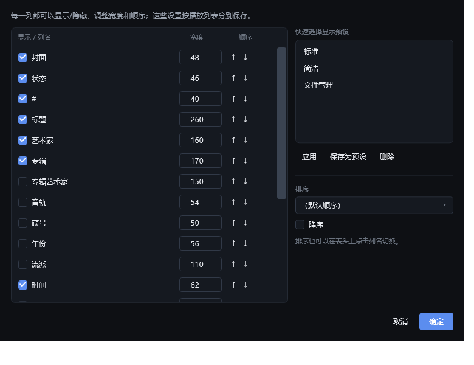

# EchoGarage

EchoGarage 是一个面向个人使用的 Windows 本地音乐播放器，目标是只保留真正需要的功能，并把每一项做到顺手：
快速启动、快速加载、可自定义的播放列表显示、真实的文件标签读写，以及共享 / WASAPI 独占两种输出方式。

当前版本：**v0.1.0**（可运行的第一版，功能持续迭代中）。


### 界面一览

| 列与布局 | 标签属性 |
| --- | --- |
|  |  |

| 智能播放列表 | 设置 |
| --- | --- |
|  |  |

| 深色主题 | 文件关联 |
| --- | --- |
|  |  |

## 功能

### 界面
- 提供**白色基底浅色**（默认）与**深色**两套主题，视图菜单或设置中切换后立即生效，并保存到配置。
- 所有界面颜色由主题字典（`DynamicResource`）驱动，后续新增主题不需要改控件代码。
- 深色 / 浅色都会同步调整窗口标题栏；对话框跟随当前主题。

### 播放
- 支持 WAV、FLAC、MP3、AAC/M4A（以及系统 Media Foundation 能解码的 WMA、AIFF、MP4 音频）。
- 输出设备选择；共享模式与 WASAPI 独占模式切换（独占模式会独占声卡，其他程序无法同时出声）。
- 进度条点击 / 拖动跳转，上一首 / 下一首 / 停止；无播放时进度条回到最左侧并禁用；音量条实时显示百分比，静音时按钮高亮并显示“静音”。
- 播放失败自动跳过并写入日志；播放计数与最近播放时间写入媒体库。

### 媒体库
- 添加任意数量本地文件夹到媒体库，递归扫描支持的音频文件。
- 扫描采用“文件大小 + 修改时间”比对，未变化的文件不会重复读标签，因此重复扫描很快；若缓存行缺少时长（旧版本读取失败留下的无效缓存），会被判定为失效并在下次扫描时自动重建。
- 标签读取并行执行（最多 8 个线程）；扫描阶段以 `Average | PictureLazy` 读取标签，不把内嵌封面读入内存，避免为每首歌复制大图。
  实测 2,825 首重新索引约 1–1.5 秒（缓存命中；首次导入受磁盘与安全软件影响会更慢）。
- `FileSystemWatcher` 监听媒体库目录：新增 / 修改 / 删除 / 重命名会自动同步，去抖后只处理变化的文件。
- 标签与封面从音频文件读取；封面按专辑缓存到可配置的缓存目录，未找到封面也会记录负缓存，避免反复解析。

### 播放列表
- **普通播放列表**：手动添加、拖拽文件、从媒体库添加、移除歌曲。
- **智能播放列表**：由筛选条件生成（字段 + 比较方式 + 值，支持“全部条件 / 任一条件”），锁定条件，不允许手动增删歌曲。
- **默认播放列表**：从资源管理器“用 EchoGarage 打开”多个文件时，自动用这些文件覆盖默认播放列表并开始播放。
- 所有非智能播放列表都接受把文件 / 文件夹拖进窗口追加。
- 播放列表支持媒体库目录以外的文件；这些文件只存在于播放列表中，不进入媒体库。
- 文件被删除或移动后，播放列表中的条目会以半透明显示并在悬停时提示，双击会提示文件不存在。
- 显示格式按播放列表分别记忆：列的显示 / 隐藏、宽度、顺序、排序列与升降序；可保存为全局预设并快速套用
  （表头旁的“预设”按钮可直接切换），媒体库视图有独立的显示格式。
- 按专辑分组时：分组标题压缩为一行（专辑 / 专辑艺术家 / 年份 + 分隔线）；封面放在该专辑左侧的独立封面栏，纵向覆盖整组歌曲（foobar2000 风格），歌曲列在封面右侧。拖动表头“封面”栏右缘即可调整封面大小（48–320px，按播放列表分别记忆），取消分组则恢复逐行小封面。
- 歌曲之间的 1px 浅色分割线延伸至整行右缘；分组头与分割线颜色都使用主题令牌，深色 / 浅色主题一致。

### 快捷键

| 按键 | 功能 |
| --- | --- |
| 双击歌曲 / Enter | 播放选中歌曲 |
| 空格 | 播放 / 暂停 |
| Alt+Enter | 打开选中歌曲的属性（标签编辑） |
| Delete | 从当前普通播放列表移除所选歌曲 |
| Ctrl+O | 添加文件到当前播放列表 |
| F5 | 重新扫描媒体库 |
| Ctrl+F | 打开“列与布局” |
| Ctrl+M | 静音 / 取消静音 |

### 标签编辑
- 右键歌曲 → 属性：查看 / 编辑标题、艺术家、专辑、专辑艺术家、流派、年份、音轨号、碟号、备注与封面。
- 标签**直接写入音频文件**（MP3/FLAC/M4A/WAV 各自的标准标签），不会写进播放器数据库。
- 保存后立即重新读取文件并刷新列表、当前播放信息与封面缓存。

### 配置
- 软件配置（`settings.json`）与媒体库数据（`library.db`）分离。
- 配置可导出 / 导入；导入不会影响媒体库与播放列表。
- 缓存目录可配置，修改后自动迁移已有封面缓存；支持一键清空缓存。
- 文件关联是**可选的手动操作**：在“文件关联”对话框里勾选需要关联的格式后才会写入；启动时不会自动注册，
  也不会改写现有的默认打开方式。Windows 10/11 需在系统“默认应用”里确认。

## 技术栈

| 层 | 选型 |
| --- | --- |
| 运行时 | .NET 10（WPF，x64） |
| UI | WPF，自绘多主题（深色 / 浅色），无第三方 UI 框架 |
| 播放 | NAudio 2.2（`WasapiOut` / `AudioFileReader` / `WdlResamplingSampleProvider`） |
| 标签 | TagLib# 2.3（`TagLibSharp`） |
| 数据 | SQLite（`Microsoft.Data.Sqlite` + Dapper，WAL 模式） |
| 日志 | 自研文件日志，按天分文件，保留 30 天 |
| 测试 | xUnit v3（进程内测试运行器） |

## 项目结构

```
EchoGarage.sln
├─ src/
│  ├─ EchoGarage.Core/           领域模型、设置模型、智能查询、布局规则（无 UI / IO 依赖）
│  ├─ EchoGarage.Infrastructure/ SQLite 仓储、扫描器、文件监听、TagLib、封面缓存、NAudio 播放器、日志
│  └─ EchoGarage.App/            WPF 应用：窗口、视图模型、对话框、单实例、文件关联
├─ tests/EchoGarage.Tests/       单元与集成测试
├─ docs/
│  ├─ adr/                       架构决策记录（ADR，需 owner 批准后写入）
│  ├─ kb/                        长期知识库（KB，需 owner 批准后写入）
│  └─ proposals/                 待 owner 审核的 ADR / KB 提案
└─ scripts/                      构建、测试、发布脚本
```

## 开发

### 环境要求

- Windows 10 1809+ / Windows 11
- .NET 10 SDK（含 Windows Desktop 运行时）
- 可选：ffmpeg（仅用于生成本地测试音频）

### 构建与运行

```powershell
dotnet build EchoGarage.sln
dotnet run --project src/EchoGarage.App
```

### 测试

测试项目使用 xUnit v3 进程内运行器，直接运行可执行文件即可（不依赖 VSTest 宿主）：

```powershell
dotnet build tests/EchoGarage.Tests
.\tests\EchoGarage.Tests\bin\Debug\net10.0-windows\EchoGarage.Tests.exe
```

或 `.\scripts\test.ps1`。

### 发布

```powershell
.\scripts\publish.ps1
# 输出：artifacts/publish/win-x64/EchoGarage.exe（依赖已安装的 .NET 10 Desktop Runtime）
```

### 目录与环境变量

EchoGarage 默认是**便携软件**：所有状态都放在 exe 所在目录，不读取 `%APPDATA%` / `%LOCALAPPDATA%`。

| 内容 | 默认位置 |
| --- | --- |
| 配置 | `<exe 目录>\EchoGarageData\config\settings.json` |
| 数据库 / 日志 / 默认缓存 | `<exe 目录>\EchoGarageData\data\` |
| 缓存目录 | 默认 `<exe 目录>\EchoGarageData\data\Cache`，可在设置中修改 |

因此程序文件夹需要可写（不要放在 `C:\Program Files` 之类受保护的位置）。实际使用的目录显示在“设置 → 关于”中。

设置环境变量 `ECHOGARAGE_DATA_DIR` 可以把以上全部内容重定向到指定目录（适合测试、共享盘或程序目录只读的情况）：

```powershell
$env:ECHOGARAGE_DATA_DIR = "G:\EchoGarageData"
.\artifacts\publish\win-x64\EchoGarage.exe
```

### 开发诊断开关

- `--screenshot <path>`：加载完成后把主窗口渲染成 PNG（高 DPI 屏幕上比外部截屏可靠）。
- `--screenshot-all <dir>`：依次打开各对话框并截图，用于检查界面。

## 已知限制（v0.1.0）

- 仅支持 Windows。
- 暂不支持无缝播放、ReplayGain、DSP、均衡器、歌词、网络串流、音乐库外的自动目录扫描。
- 评分仅保存在数据库，不回写文件（不伪造非标准标签）。
- 智能播放列表条件基于媒体库内歌曲；播放列表布局随播放列表保存，媒体库布局保存在配置中。
- 导入大量文件（数万首）时首次扫描需要时间，之后依靠增量比对。

## 路线图

- 播放队列与“下一首播放”、随机 / 循环模式、无缝播放。
- 播放列表内搜索与过滤、按专辑 / 艺术家分组的侧栏浏览。
- 更多界面主题（高对比度、跟随系统深浅色）。
- 更多标签字段与批量编辑、封面批量抓取。
- 更细的缓存策略与数据库迁移机制。

## 文档

- `README.md`：项目介绍与开发指引（本文件）。
- `AGENTS.md`：面向自动化 agent 的操作规范与目录说明。
- `docs/adr/`：已批准的架构决策记录，索引见 `docs/adr/ADR-index.md`。
- `docs/kb/`：已批准的长期知识库（NAudio、WPF、TagLib、性能基线等）。
- `docs/proposals/`：尚未批准的 ADR / KB 提案；批准后才移入 `docs/adr/` 或 `docs/kb/`。
